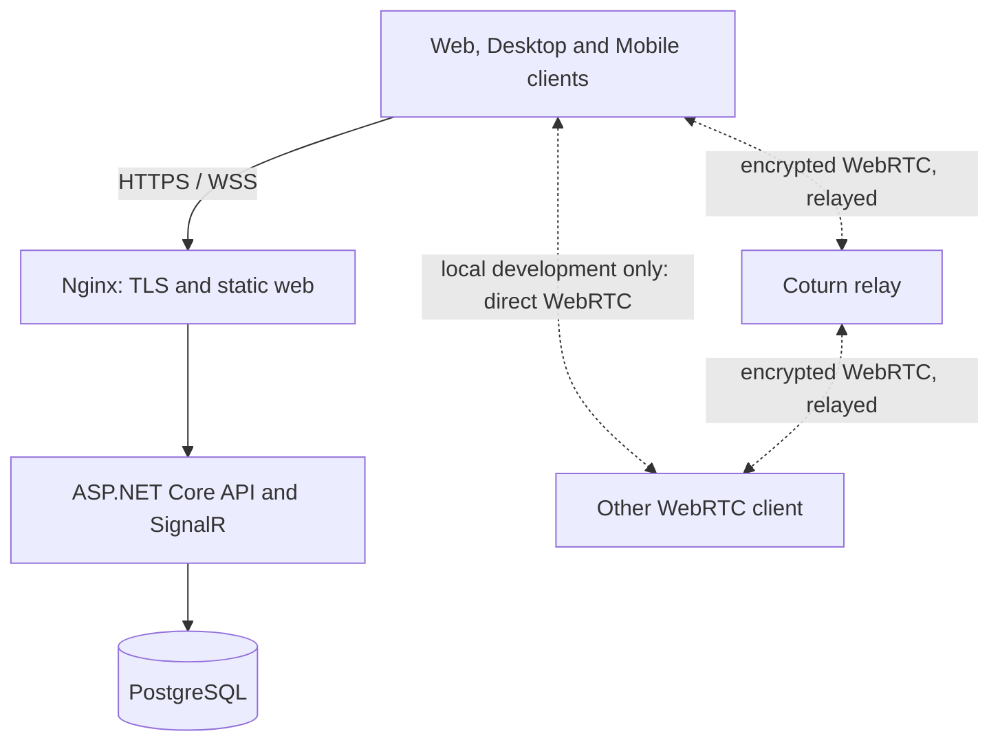

# Architecture

## System context

ArcaneLink is one centralized service. Clients connect to the official
deployment through HTTPS and WebSocket-compatible endpoints. Nginx terminates
TLS and serves the web application, the ASP.NET Core backend owns application
state and authorization, PostgreSQL stores persistent relational data, and
Coturn provides mandatory relay-only WebRTC connectivity in Production and is
optional only for explicit local development.

The signaling and authorization path is always centralized. The official
production policy relays media through Coturn to avoid direct peer candidate
use; local development may use direct connectivity. Authenticated clients
obtain short-lived HMAC credentials from the backend, while the shared Coturn
secret remains server-side. Media is not server-mixed in `1.0.0-rc.1`: a TURN
relay transports encrypted WebRTC packets but is not an SFU.

## Backend

The backend exposes REST endpoints and SignalR realtime operations. Its main
responsibilities are:

- authentication, refresh sessions and account security;
- server, membership, role and permission state;
- spaces, messages, read state, search and notifications;
- invites, join requests, moderation, bans and audit events;
- voice-room presence and WebRTC signaling;
- file metadata, optimized variants and retention policy;
- health, migration and operational diagnostics.

EF Core migrations are retained in source and applied in order. The entire
migration history is part of the release because it supports both clean
database creation and controlled upgrades.

## Authorization

Access decisions are evaluated on the backend. The role model uses a stable,
versioned granular permission registry, role masks, hierarchy rules and
resource-specific overrides. Owners remain a distinct top-level authority.
Client capability flags only control presentation; they are never the final
security boundary.

Older coarse permission rows are preserved as a compatibility source during
the migration to granular permissions. Runtime adapters and migration
backfills are tested so that existing installations retain their intended
access while new permission checks use the exact operation code.

## Frontend and wrappers

`frontend/client.web` is the single web application source. Desktop and mobile
projects are packaging layers around that product rather than independent
forks:

- Electron loads the configured ArcaneLink origin in a hardened desktop shell.
- Capacitor Android opens the official HTTPS service through a native shell;
  a local synchronized build is retained for tooling and fallback assets, not
  as an independent cross-origin backend client.

Release signing credentials and vendor-store material are deliberately kept
outside the repository.

## Stored data

PostgreSQL contains authoritative structured data. User uploads and generated
variants use a dedicated persistent volume. ASP.NET Core data-protection keys
use another persistent volume. Neither runtime directory belongs in Git.

## Current scale boundary

The reference deployment is a single backend instance and a single PostgreSQL
primary. It is suitable for controlled production and academic review, but it
does not claim active-active application nodes, database failover automation,
an SFU, or global CDN orchestration.
